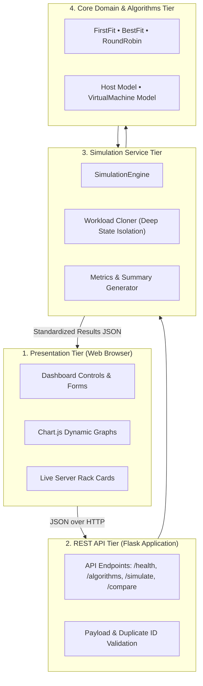
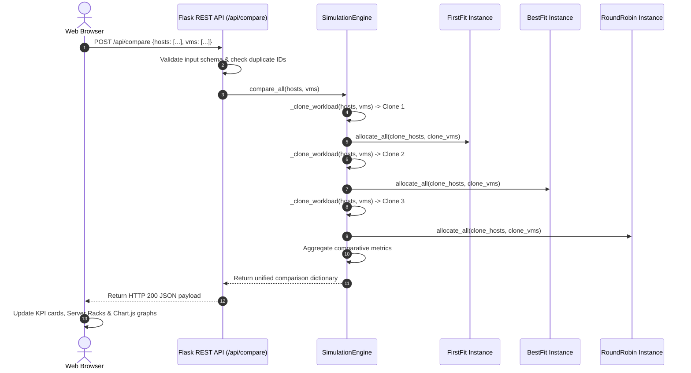

# College Project Presentation Slides

**Project Title:** Virtual Machine Resource Allocation Simulator  
**Subject:** Cloud Computing (CSE / IT)  
**Academic Year:** [ACADEMIC YEAR: 2025 – 2026]  

---

## Student Customization Checklist
Before presenting to the examination committee, please fill in your personal and institutional details wherever you see square brackets `[ ... ]`:

- [ ] **Slide 1:** `[STUDENT NAME]` — Your full name as registered in university records.
- [ ] **Slide 1:** `[REGISTER NUMBER]` — Your college registration or roll number.
- [ ] **Slide 1:** `[COLLEGE / INSTITUTION NAME]` — Your college or university campus name.
- [ ] **Slide 1:** `[CITY]` — City and state of your institution.
- [ ] **Slide 1:** `[GUIDE NAME AND DESIGNATION]` — Your internal project supervisor's name and title (e.g., *Dr. A. Sharma, Associate Professor*).
- [ ] **Slide 1:** `[ACADEMIC YEAR]` — e.g., *2025 – 2026*.

---

## Visual Design & Presentation Theme Guide

For students creating PowerPoint (`.pptx`), Google Slides, Keynote, or Marp presentations, use the following design guidelines:

### 1. Color Palette (Dark Datacenter Aesthetic)
- **Primary Background:** `#0b0f19` (Deep Obsidian / Midnight Slate)
- **Surface / Card Background:** `#1e293b` (Dark Slate Gray with subtle 1px border `#334155`)
- **Primary Text:** `#f8fafc` (Pure Crisp White, high contrast)
- **Secondary / Subtitle Text:** `#94a3b8` (Muted Slate Blue)
- **Accent 1 (Compute & Active):** `#38bdf8` (Electric Cyan / Sky Blue)
- **Accent 2 (Success & Memory):** `#10b981` (Emerald Green)
- **Accent 3 (Rejection & Warning):** `#ef4444` (Coral Rose) / `#f59e0b` (Amber Orange)

### 2. Typography & Layout Rules
- **Header Font:** Inter, Roboto, or Montserrat (Bold / Semi-bold, 32–36pt)
- **Body Font:** Inter, Open Sans, or System Sans-Serif (Regular, 18–20pt)
- **Code & Formulas:** JetBrains Mono, Fira Code, or Courier New (Monospace)
- **Rule of Thumb:** Maximum 5–6 bullet points per slide; keep bullets concise (under 12 words per line); use bold lead-ins for effortless scannability.
- **Visuals:** Every slide should feature a diagram, table, or UI mockup on the right-hand half, keeping text on the left-hand half.

---

# Presentation Deck (12 Slides)

---

## Slide 1: Title Slide

### Virtual Machine Resource Allocation Simulator
**A Web-Based Simulation System for Multi-Dimensional Cloud Resource Scheduling**

- **Candidate Name:** [STUDENT NAME]
- **Register Number:** [REGISTER NUMBER]
- **Degree / Branch:** Bachelor of Engineering / Technology in Computer Science & Engineering
- **Institution:** [COLLEGE / INSTITUTION NAME], [CITY]
- **Project Supervisor:** [GUIDE NAME AND DESIGNATION]
- **Academic Session:** [ACADEMIC YEAR: 2025 – 2026]

---
**Suggested Visual:**
A clean title slide layout featuring a dual-server rack icon, Cloud Computing badges (*IaaS*, *Multi-Dimensional Bin Packing*, *Heuristic Scheduling*), and the college institutional logo.

---
**Speaker Notes:**
> "Good morning, respected examiners and faculty members. Today, I am pleased to present my Cloud Computing mini-project titled **'Virtual Machine Resource Allocation Simulator'**.
> 
> In cloud datacenters like AWS and Microsoft Azure, efficiently placing customer virtual machine workloads onto physical servers is a foundational scheduling challenge. My project simulates, visualizes, and benchmarks three primary allocation heuristics—First Fit, Best Fit with normalized residual scoring, and Round Robin—backed by a Python Flask REST API and an interactive web dashboard.
> 
> I would like to begin by introducing the core concepts of cloud virtualization and the scheduling problem we set out to model."

---

## Slide 2: Introduction to Cloud Computing & VM Allocation

### Background & Context
- **Infrastructure as a Service (IaaS)**:
  - Cloud providers offer on-demand virtual compute, memory, and storage from large pools of physical servers.
- **Hardware Virtualization**:
  - Hypervisors partition physical host CPU and RAM into isolated Virtual Machines (VMs).
- **The Scheduling Challenge**:
  - VM resource requests arrive sequentially with heterogeneous CPU core and RAM demands.
  - Schedulers must select an accommodating physical host in real time without causing hardware bottlenecks.
- **Project Scope & Educational Nature**:
  - Pure software simulation running in Python memory.
  - Eliminates cloud infrastructure subscription costs while faithfully modeling scheduling trade-offs.

---
**Suggested Visual:**
A high-level diagram illustrating user VM requests entering a Cloud Orchestrator, which schedules them onto heterogeneous Physical Hosts.

---
**Speaker Notes:**
> "Under the IaaS cloud model, physical datacenters consist of hundreds of servers. Through virtualization, hypervisors partition each physical server's CPU cores and RAM into independent virtual machines. 
> 
> However, physical servers possess finite, independent capacity limits. When tenant applications request VMs of various sizes, the cloud scheduler must decide which physical host should run each instance. 
> 
> Because experimenting with real datacenter hardware or public cloud instances incurs significant monetary cost and risks downtime, our simulator models this scheduling tier entirely in software. It provides an interactive, zero-cost testbed for analyzing allocation trade-offs."

---

## Slide 3: Problem Statement

### Challenges in Datacenter VM Placement
- **Multi-Dimensional Resource Fragmentation**:
  - CPU cores and RAM operate on different numerical scales (integer cores vs. gigabytes of memory).
  - Placing a VM without balancing both dimensions leaves idle CPU stranded when host RAM is exhausted.
- **Risk of Hardware Over-Subscription**:
  - Exceeding rated server capacity degrades performance, violates SLAs, and triggers noisy-neighbor interference.
- **Black-Box Nature of Enterprise Schedulers**:
  - Production hypervisors (VMware ESXi, OpenStack Nova) use complex, proprietary heuristics that cannot be easily inspected or modified for academic study.
- **Need for Fair Comparative Benchmarking**:
  - Benchmarking algorithms requires testing them against the exact same workload from an identical cluster starting state.

---
**Suggested Visual:**
A diagram of a physical server showing 100% RAM consumed but 50% CPU idle (labeled *"Stranded CPU Cores due to Multi-Dimensional Imbalance"*), contrasted with an overloaded host breaching 100% capacity.

---
**Speaker Notes:**
> "The core difficulty in virtual machine placement is multi-dimensional bin packing, which is an NP-hard problem. Because CPU and memory are independent constraints, a server might run out of RAM while several CPU cores remain unused. Those CPU cores become stranded and cannot be used by new VMs.
> 
> Conversely, placing too many virtual machines onto a single server leads to hardware over-subscription and performance degradation.
> 
> Furthermore, commercial schedulers act as black boxes, making it difficult for students and engineers to observe heuristic trade-offs side by side. Our problem statement was to create an open, transparent simulation platform that evaluates these multi-dimensional trade-offs fairly under identical cluster conditions."

---

## Slide 4: Project Objectives

### Key Goals & Deliverables
- **Heterogeneous Resource Modeling**:
  - Model physical hosts and virtual machine requests with configurable CPU cores and RAM in gigabytes.
- **Three Allocation Heuristics**:
  - Implement **First Fit (FF)**, **Best Fit (BF)**, and **Round Robin (RR)**.
- **Multi-Dimensional Best Fit Formula**:
  - Design a normalized residual-resource scoring rule combining CPU and RAM into a single metric.
- **Strict Admission Control**:
  - Enforce physical capacity limits and log explicit failure reasons for unaccommodated VMs.
- **Fair Benchmark Comparison Engine**:
  - Guarantee 100% isolated, non-interfering comparisons using workload cloning.
- **Interactive RESTful Web Dashboard**:
  - Build a responsive interface with physical server rack cards and 4 real-time Chart.js charts.
- **Software Quality Assurance**:
  - Verify every component with an automated test suite containing 95 passing tests.

---
**Suggested Visual:**
A four-pillar graphic: 1. Core Domain Models, 2. Three Allocation Algorithms, 3. Simulation & Fair Comparison Engine, 4. Web Dashboard & Visualization.

---
**Speaker Notes:**
> "To address these challenges, we defined seven concrete objectives. 
> 
> First, model physical hosts and virtual machines with configurable CPU and memory. Second, implement three foundational placement heuristics: First Fit, Best Fit, and Round Robin. Third, develop a normalized residual-resource formula for Best Fit that balances CPU and RAM. 
> 
> Fourth, enforce strict admission control so no server is ever over-allocated. Fifth, build a comparison engine that isolates algorithm runs so they start from identical initial states. Sixth, present the results on a responsive web dashboard with live server rack visualizations. And finally, verify the entire system with 95 automated unit and integration tests."

---

## Slide 5: Technology Stack

### End-to-End Technology Architecture
| Layer | Technology | Key Responsibility |
| :--- | :--- | :--- |
| **Backend Language** | Python 3.13 | Core domain logic, mathematical scoring, state cloning |
| **Web API Framework** | Flask 3.1 | RESTful routing, application factory, JSON error handling |
| **Automated Testing** | Pytest 9.1 | Automated unit and integration testing (95 passing tests) |
| **Frontend UI** | HTML5 / Vanilla CSS3 | Dark datacenter design system, responsive grid layout |
| **Frontend Logic** | Vanilla JavaScript (ES6) | REST API fetch calls, DOM updates, preset management |
| **Data Visualization** | Chart.js 4.4 (CDN) | Interactive bar, stacked bar, and doughnut charts |

- **Design Philosophy**:
  - Zero heavy frontend build chains (no Webpack, React, or npm compilation).
  - Maximum educational transparency and cross-platform portability.

---
**Suggested Visual:**
A technology stack diagram displaying logos for Python, Flask, Pytest, HTML5, CSS3, JavaScript, and Chart.js.

---
**Speaker Notes:**
> "We selected Python 3.13 and Flask for the backend to keep the architecture clean, lightweight, and focused purely on domain logic. Flask's application factory and blueprint architecture allow us to structure routes cleanly without heavy database dependencies.
> 
> On the frontend, we deliberately chose Vanilla HTML5, modern CSS3, and ES6 JavaScript with Chart.js. This avoids complex build pipelines like Webpack or npm, ensuring the simulator runs immediately on any computer with Python installed. 
> 
> For software verification, we chose pytest, which executes our 95 unit and integration tests in less than one second."

---

## Slide 6: System Architecture

### 4-Tier Decoupled Architecture

### Explanation of the Architecture Diagram
- **Tier 1 (Presentation):** The user browser renders server rack cards, summary KPIs, and Chart.js charts; it communicates with the backend exclusively via JSON over HTTP.
- **Tier 2 (REST API):** Flask validates incoming JSON payloads, checks numeric boundaries, catches duplicate IDs, and translates domain responses into standardized HTTP status codes.
- **Tier 3 (Simulation Service):** `SimulationEngine` clones the incoming cluster state so that comparative benchmarks execute against pristine, identical copies.
- **Tier 4 (Core Domain):** Contains pure Python `Host` and `VirtualMachine` models and allocation algorithms; completely decoupled from Flask or HTTP concepts.

---
**Speaker Notes:**
> "Here we see the 4-tier decoupled architecture of our system. 
> 
> Tier 1 is the browser presentation layer. When a user runs a simulation or loads a preset, Tier 2—the Flask REST API—receives the request, validates the payload, and ensures no duplicate host or VM IDs exist.
> 
> Tier 2 delegates execution to Tier 3, the Simulation Engine. This layer is crucial: it clones the host cluster and VM queue so that algorithms run in complete isolation. 
> 
> Finally, Tier 4 contains our pure Python domain models and algorithms. Notice that Tier 4 has no awareness of Flask or HTTP. This strict separation of concerns makes our algorithms modular and easy to test."

---

## Slide 7: Allocation Heuristics: First Fit, Best Fit, & Round Robin

### Algorithmic Comparison & Operational Trade-Offs

| Attribute | First Fit (FF) | Best Fit (BF) | Round Robin (RR) |
| :--- | :--- | :--- | :--- |
| **Search Strategy** | Scans from host 0; picks first host that fits | Evaluates all hosts; picks minimum residual score | Cycles sequentially across host ring |
| **Search Complexity** | Best: $O(1)$, Worst: $O(N)$ | Always $O(N)$ (inspects all hosts) | Worst: $O(N)$ |
| **Cluster Impact** | Packs the front of the cluster heavily | Maximizes packing density; saves whole hosts | Distributes workload and heat evenly |
| **Primary Strength** | Fast allocation decision with low overhead | High packing density; leaves room for large VMs | Prevents hotspots and hardware wear |
| **Primary Weakness** | Leaves trailing hosts idle | Can leave small, unusable resource slivers | Fragments cluster earlier under heavy loads |

- **Key Takeaway**: No algorithm is universally superior. Cloud operators choose their heuristic based on whether their priority is energy conservation (Best Fit), fast scheduling (First Fit), or thermal load balancing (Round Robin).

---
**Suggested Visual:**
A 3-column graphic illustrating: First Fit packing Host 1 first; Best Fit picking Host 2 because it matches the VM size closely; Round Robin spreading VMs across Host 1, Host 2, and Host 3.

---
**Speaker Notes:**
> "Let us examine our three allocation algorithms.
> 
> First Fit scans from host index zero and allocates the VM to the very first server that can accommodate it. It is computationally fast, but it heavily loads the front of the cluster while leaving trailing hosts idle.
> 
> Best Fit evaluates all candidate hosts and chooses the server that will have the smallest remaining capacity after placement. It maximizes packing density, freeing up other servers for energy conservation or large workloads.
> 
> Round Robin cycles sequentially through the server ring. It prioritizes load balancing, spreading thermal load and wear evenly across all machines.
> 
> A critical takeaway of our project is that no single algorithm is 'the best' in all scenarios; each serves a specific operational goal."

---

## Slide 8: Best Fit Formula, Worked Example & Metric Formulas

### Mathematical Model for Multi-Dimensional Scoring
For every feasible host capable of accommodating VM $V$:

$$\text{Score}(H, V) = \left( \frac{\text{remaining\_cpu} - \text{vm.cpu\_required}}{\text{total\_cpu}} \right) + \left( \frac{\text{remaining\_ram} - \text{vm.ram\_required}}{\text{total\_ram}} \right)$$

- **Lower Score = Tighter Fit** (least stranded capacity remaining on the host).
- **Tie-Breaking Rule**: Deterministically selects the candidate host with the **lowest list index**.

### Numerical Worked Example (From Project Test Suite)
- **Host 0**: 4 Cores, 8 GB RAM (Available: 4 Cores, 8 GB RAM)
- **Host 1**: 8 Cores, 16 GB RAM (Available: 8 Cores, 16 GB RAM)
- **Incoming VM**: Requires **4 Cores** and **8 GB RAM**

$$\text{Score}_{\text{Host 0}} = \left(\frac{4 - 4}{4}\right) + \left(\frac{8 - 8}{8}\right) = \frac{0}{4} + \frac{0}{8} = \mathbf{0.0}$$

$$\text{Score}_{\text{Host 1}} = \left(\frac{8 - 4}{8}\right) + \left(\frac{16 - 8}{16}\right) = \frac{4}{8} + \frac{8}{16} = 0.5 + 0.5 = \mathbf{1.0}$$

$$\text{Decision: } \mathbf{0.0 < 1.0} \implies \text{Best Fit allocates the VM to Host 0.}$$

### System Metric Formulas
- **Allocation Success Rate (%)** $= \left( \frac{\text{Allocated VMs}}{\text{Total Requested VMs}} \right) \times 100$
- **Host Resource Utilization (%)** $= \left( \frac{\text{Allocated Resource}}{\text{Total Resource Capacity}} \right) \times 100$
- **Cluster Resource Utilization (%)** $= \left( \frac{\sum \text{Allocated Resource across all Hosts}}{\sum \text{Total Resource Capacity across all Hosts}} \right) \times 100$

---
**Speaker Notes:**
> "Because CPU cores and RAM in gigabytes have completely different numerical scales, you cannot simply add raw remaining cores to raw remaining gigabytes. 
> 
> In our Best Fit implementation, we divide the projected remaining CPU by total host CPU, and projected remaining RAM by total host RAM. This normalizes both dimensions into unitless fractions between 0.0 and 1.0. A score of 0.0 represents a perfect, snug fit.
> 
> In this worked example from our test suite, Host 0 achieves a score of 0.0 because the VM consumes all its resources, while Host 1 scores 1.0. Best Fit chooses Host 0, preserving Host 1 completely intact for future large workloads. If two hosts produce identical scores, our tie-breaker deterministically selects the lowest list index."

---

## Slide 9: Simulation Workflow & REST API Architecture

### RESTful API Contract
| Endpoint | HTTP Method | Input Payload | Output / Key Result |
| :--- | :---: | :--- | :--- |
| `/api/health` | `GET` | None | Service liveness confirmation (`{"status": "healthy"}`) |
| `/api/algorithms` | `GET` | None | Supported heuristics (`first_fit`, `best_fit`, `round_robin`) |
| `/api/simulate` | `POST` | `{ algorithm, hosts, vms }` | Single algorithm execution metrics, rack states, VM outcomes |
| `/api/compare` | `POST` | `{ hosts, vms }` | Side-by-side benchmark summary across all 3 algorithms |

### Workflow Sequence Diagram

### Explanation of the Workflow Diagram
- The client dispatches a single `POST` request to `/api/compare`.
- The engine creates three separate deep copies of the hosts and VMs using `_clone_workload()`.
- Each algorithm runs against its own clone, guaranteeing that First Fit cannot alter the initial host capacity for Best Fit or Round Robin.
- Results are merged into a single JSON response that populates the dashboard tables and Chart.js graphs.

---
**Speaker Notes:**
> "Our REST API exposes four endpoints. The core endpoint is `/api/compare`. 
> 
> As shown in this sequence diagram, when the user clicks 'Compare All Algorithms', the browser sends the hosts and VMs in a single POST request. 
> 
> Inside the backend, the Simulation Engine invokes `_clone_workload()` three times. Clone one runs First Fit, clone two runs Best Fit, and clone three runs Round Robin. Because each algorithm executes against a fresh copy, no algorithm inherits mutated host capacities from another. 
> 
> The engine aggregates the metrics into a standardized JSON response, which the frontend uses to render our charts and server racks in one smooth update."

---

## Slide 10: Interactive Dashboard & Visualizations

### Visual Features & UI Highlights
- **KPI Summary Cards**:
  - Live statistics for Total Hosts, Total VMs, Allocated VMs, Failed Allocations, and Cluster CPU & RAM utilization bars.
- **Physical Server Rack Visualizer**:
  - Displays virtual server nodes with visual CPU and RAM capacity meters.
  - Hosted VMs appear as clickable pill tags showing resource footprints (e.g., `vm-web-1 (2C/4G)`).
- **Four Dynamic Chart.js Visualizations**:
  1. *Per-Host Utilization (Bar Chart)*: CPU % vs. RAM % utilization for each physical server.
  2. *Algorithm Comparison (Grouped Bar Chart)*: Success Rate %, CPU Util %, and RAM Util % across all three heuristics.
  3. *Total Cluster Capacity (Stacked Bar Chart)*: Allocated vs. Remaining CPU cores and RAM in GB.
  4. *Allocation Outcomes (Doughnut Chart)*: Proportion of Allocated vs. Rejected VMs.
- **Workload Presets & Modal Safeguards**:
  - Four built-in scenarios: Balanced, CPU-Heavy, RAM-Heavy, and Overloaded Cluster.
  - Custom accessible in-app confirmation modal prevents accidental loss of custom inputs.

---
**Suggested Visual:**
A screenshot or high-fidelity mockup of the dark-themed dashboard showing the server racks, KPI cards, and Chart.js graphs.

---
**Speaker Notes:**
> "The dashboard is designed as a modern datacenter monitoring console. 
> 
> At the top, five KPI cards display high-level cluster metrics. In the center, our server rack visualizer renders individual host cards. Each card displays progress bars for CPU and RAM, as well as pill tags representing the virtual machines hosted on that server.
> 
> Below the server racks, four Chart.js graphs visualize per-host utilization, a 3-way algorithm comparison, total cluster capacity breakdown, and successful versus rejected VM ratios. 
> 
> We also incorporated four workload presets and a custom in-app modal that prevents users from accidentally overwriting their configurations."

---

## Slide 11: Testing Results & Sample Observations

### Verification Suite: 95 Passing Tests (100% Pass Rate)
- `tests/test_models.py` (34 tests): Boundary capacities, numeric validation, boolean type rejection, `.clone()` independence.
- `tests/test_algorithms.py` (14 tests): Heuristic placement logic, Best Fit residual formula, tie-breaking rules, capacity limits.
- `tests/test_simulator.py` (20 tests): Fair comparison isolation, metric calculations, empty inputs, determinism.
- `tests/test_api.py` (27 tests): HTTP status codes (200, 400, 404, 405), payload validation, standardized error envelopes.

### Sample Experimental Observations (Built-In Presets)
| Workload Preset | Cluster Capacity | Workload Demand | FF Success % | BF Success % | RR Success % | Rejection Behavior |
| :--- | :--- | :--- | :---: | :---: | :---: | :--- |
| **Balanced** | 3 Hosts (32C / 64G) | 6 VMs (18C / 40G) | **100.0%** | **100.0%** | **100.0%** | 0 rejections; all accommodated |
| **CPU-Heavy** | 3 Hosts (40C / 40G) | 5 VMs (32C / 16G) | **100.0%** | **100.0%** | **100.0%** | 0 rejections; CPU bounds tested |
| **RAM-Heavy** | 3 Hosts (20C / 80G) | 4 VMs (8C / 64G) | **100.0%** | **100.0%** | **100.0%** | 0 rejections; memory bounds tested |
| **Overloaded** | 2 Hosts (8C / 16G) | 5 VMs (25C / 50G) | **40.0%** | **40.0%** | **40.0%** | **3 VMs rejected; reasons logged** |

---
**Suggested Visual:**
A terminal screenshot showing `pytest -v tests/` output with 95 green `PASSED` lines, alongside the comparison table from the Overloaded preset.

---
**Speaker Notes:**
> "To guarantee software reliability, we built an automated test suite of 95 tests across our models, algorithms, simulation service, and REST API. Running pytest confirms a 100% pass rate in under one second.
> 
> As shown in our experimental results table, when the cluster has sufficient capacity—such as in the Balanced, CPU-Heavy, and RAM-Heavy presets—all three algorithms successfully place 100% of the VMs. 
> 
> However, under the Overloaded preset—where 25 cores and 50 GB RAM are requested on an 8-core, 16 GB cluster—our admission control successfully intercepts the overflow. All three algorithms allocate the first two VMs and reject the remaining three with explicit failure reasons, preventing host over-allocation."

---

## Slide 12: Conclusion, Limitations, & Future Enhancements

### Conclusion
- Successfully built a modular, web-based VM resource allocation simulation platform.
- Demonstrated multi-dimensional bin-packing trade-offs, admission control, and normalized scoring.
- Validated fair comparative benchmarking across First Fit, Best Fit, and Round Robin.

### System Limitations
- **Static Workload Model**: VMs arrive sequentially without dynamic departure or lifespan clocks.
- **In-Memory Volatility**: Data resets when the Flask development server restarts (no persistent database).
- **Single-Cluster Horizon**: Network latency, inter-rack topology, and electrical power consumption are not modeled.

### Future Enhancements
- **Dynamic VM Defragmentation**: Implement Live VM Migration to consolidate underutilized hosts and power off idle servers.
- **Metaheuristic Schedulers**: Integrate Genetic Algorithms (GA) or Particle Swarm Optimization (PSO) for multi-objective optimization (energy vs. SLA).
- **Database Persistence**: Add SQLite or PostgreSQL to persist custom cluster topologies and historical benchmark runs.

---
**Suggested Visual:**
A summary card highlighting: *100% Test Pass Rate • 3 Allocation Heuristics • 4 Interactive Charts • Clean REST API Architecture*.

---
**Speaker Notes:**
> "In conclusion, our simulator provides an accessible, mathematically rigorous platform for understanding cloud resource allocation. It models physical capacity constraints, guarantees fair comparison, and visualizes outcomes through an intuitive dashboard.
> 
> The project has clear boundaries: it models static allocation rather than dynamic VM departures, and runs in memory. 
> 
> In future work, this simulator can be extended with dynamic VM lifecycles, live migration defragmentation, and metaheuristic algorithms like Genetic Algorithms.
> 
> Thank you, respected examiners and faculty members. I am now pleased to demonstrate the live application and answer your questions."

---

\newpage

# Part B: Final Viva Defense Preparation

---

## 1. The 60-Second Opening Pitch
> "Good morning, professors. My project is the **Virtual Machine Resource Allocation Simulator**, developed for the Cloud Computing curriculum.
> 
> In cloud datacenters, hypervisors must allocate incoming virtual machine resource requests across physical servers without causing hardware over-allocation or resource fragmentation.
> 
> My project implements and compares three primary heuristics: **First Fit**, **Best Fit** using normalized residual-resource scoring, and **Round Robin**. The system is built with a decoupled Python and Flask REST API, paired with an interactive web dashboard utilizing Chart.js and live server rack visualizers.
> 
> Most importantly, the simulator guarantees **fair comparison** by running workloads on cloned, isolated copies of identical cluster configurations. The system is verified by 95 automated unit and integration tests with a 100% pass rate.
> 
> I am ready to demonstrate the live simulator and walk through the code."

---

## 2. Ten Likely Viva Questions & Concise Answers

### Q1: What cloud service model does this simulator represent?
**Answer:** It models **Infrastructure as a Service (IaaS)**. In IaaS, cloud providers virtualize raw physical compute and memory hardware into Virtual Machines (VMs) for tenant workloads.

### Q2: Why is VM resource allocation considered an NP-hard problem?
**Answer:** Because it maps directly to the **Multi-Dimensional Vector Bin Packing Problem**. Finding an optimal allocation that minimizes active servers across two independent resource dimensions (CPU cores and RAM) is computationally intractable for large numbers of hosts, requiring heuristic solutions in practice.

### Q3: How does your Best Fit formula combine CPU cores and RAM in gigabytes?
**Answer:** It uses normalized residual scoring:
$$\text{Score} = \left(\frac{\text{remaining\_cpu} - \text{vm.cpu\_required}}{\text{total\_cpu}}\right) + \left(\frac{\text{remaining\_ram} - \text{vm.ram\_required}}{\text{total\_ram}}\right)$$
Dividing remaining resources by total capacity converts both integer cores and RAM gigabytes into unitless fractions between 0.0 and 1.0, enabling a fair combined score. The host with the lowest score (closest fit) is selected.

### Q4: How does Best Fit break ties when two hosts have the exact same score?
**Answer:** It uses a deterministic tie-breaking rule: if multiple candidate hosts yield the same residual score, the algorithm selects the host with the **lowest list index**.

### Q5: What is the primary operational trade-off between Best Fit and Round Robin?
**Answer:** **Best Fit** maximizes packing density, consolidating workloads onto fewer servers to allow idle machines to enter low-power sleep modes. **Round Robin** distributes workloads evenly across all hosts, preventing thermal hotspots and reducing hardware wear, but leaving fewer completely empty servers.

### Q6: What happens if a requested VM exceeds the remaining capacity of all hosts?
**Answer:** The system's **admission control** safely rejects the VM. The VM's status is set to `REJECTED`, the host list remains unmodified, and the rejection reason is logged in `failed_allocations`. The simulator does not crash or over-allocate hardware.

### Q7: How does your system guarantee fair comparison between algorithms?
**Answer:** In `SimulationEngine.compare_all()`, the helper method `_clone_workload()` creates independent deep copies of the host cluster and VM queue for each algorithm. Each heuristic starts from the exact same initial state without carrying over state mutations from previous runs.

### Q8: Why did you choose Flask over a heavier framework like Django?
**Answer:** Flask is lightweight, unopinionated, and provides application factories and blueprints without forcing an ORM database layer or administrative overhead, which are unnecessary for an in-memory scheduling simulation.

### Q9: Why must you call `.destroy()` on Chart.js instances before updating?
**Answer:** Chart.js binds directly to the HTML5 `<canvas>` rendering context. If a new chart instance is created on an existing canvas without calling `.destroy()`, the previous chart remains active underneath, causing visual flickering, memory leaks, and broken hover tooltips.

### Q10: How many automated tests exist, and what do they verify?
**Answer:** There are **95 automated tests** in total: 34 tests for domain models and numeric capacity validation, 14 tests for allocation algorithm logic and tie-breaking, 20 tests for the simulation engine and fair comparison isolation, and 27 tests for Flask REST API routes and HTTP status codes.

---

## 3. Five Common Presentation Mistakes to Avoid

1. **Claiming the system deploys real virtual machines**:
   - *Correction:* Clearly emphasize that this is an **educational software simulation in Python memory**. It simulates hypervisor placement logic; it does not invoke KVM, QEMU, or AWS APIs.
2. **Claiming one algorithm is universally "the best"**:
   - *Correction:* Emphasize trade-offs. Best Fit is best for server consolidation; Round Robin is best for thermal load balancing; First Fit is best for fast scheduling decisions.
3. **Reading bullet points verbatim from slides**:
   - *Correction:* Use the slide bullets as visual anchors for examiners, and deliver the explanation naturally using the provided speaker notes.
4. **Fumbling during preset loading**:
   - *Correction:* Remember that loading a preset opens an in-app confirmation modal. Explain to examiners that this safeguard prevents accidental loss of custom cluster configurations.
5. **Treating rejected VMs as a system defect**:
   - *Correction:* Highlight rejected VMs under the Overloaded preset as positive proof of **working admission control** and SLA enforcement.

---

## 4. Checklist for Live Demonstration

### Pre-Demo Preparation (Before Entering the Room)
- [ ] **Laptop & Power**: Laptop plugged in; display resolution set to 1080p for clear projection.
- [ ] **PowerShell Terminal Open**: Navigated to project root directory:
  `cd "c:\Users\gkt35\full stack training\My Projects\CC Project"`
- [ ] **Virtual Environment Activated**: Confirm `(.venv)` appears in the prompt (`.venv\Scripts\Activate.ps1`).
- [ ] **Pre-Run Pytest**: Execute `.venv\Scripts\pytest -v tests/` to verify all 95 tests pass.
- [ ] **Server Launched**: Run `.venv\Scripts\python run.py` (serving on `http://127.0.0.1:5000`).
- [ ] **Browser Window Open**: Chrome or Edge opened to `http://127.0.0.1:5000` with DevTools closed.
- [ ] **Internet Access Confirmed**: Ensure internet connection is active so Chart.js loads from CDN.

### 5-Minute Live Demonstration Script
1. **Minute 1: Introduction & Dashboard Standby State**
   - Point out the dark datacenter aesthetic and the green **API Online** badge.
   - Point out the 5 KPI summary cards in standby mode (`--`).
   - Show the initial 3 hosts (Node Alpha, Node Beta, High Compute) and 6 VMs in the Balanced preset.
2. **Minute 2: Run First Fit Simulation**
   - Select **First Fit** and click **Run Simulation**.
   - Show how Node Alpha and Node Beta are packed first, while High Compute receives the remaining load.
   - Point out the live server rack cards with CPU/RAM progress bars and VM pill tags (e.g., `vm-web-1 (2C/4G)`).
3. **Minute 3: Run Best Fit & Round Robin**
   - Switch algorithm to **Best Fit**; explain how normalized residual scoring prioritizes tightest fits.
   - Switch algorithm to **Round Robin**; point out how VMs cycle evenly across the hosts.
4. **Minute 4: Execute Fair Comparison Mode**
   - Click **Compare All Algorithms**.
   - Show the comparison table and the grouped bar chart displaying Success Rate %, CPU Util %, and RAM Util % across all three heuristics side by side.
   - Explain that `_clone_workload()` guarantees each algorithm received the exact same initial cluster state.
5. **Minute 5: Admission Control on Overloaded Preset**
   - Click the **Overloaded Cluster** preset button; accept the in-app confirmation modal.
   - Click **Compare All Algorithms**.
   - Show that 2 VMs are allocated and 3 VMs are marked with red **REJECTED** badges.
   - Scroll down to the Rejection Log and read the explicit failure reasons (e.g., *Insufficient CPU / RAM across all available hosts*).
   - Conclude by stating that admission control successfully prevented hardware over-allocation.
